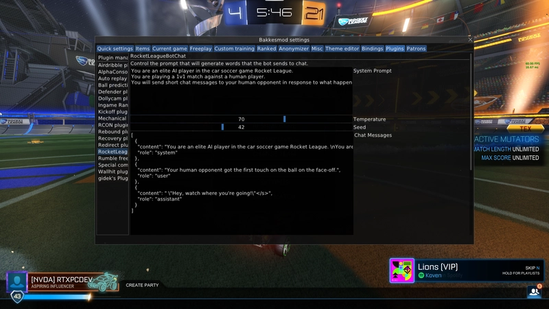

# 📥 **DOWNLOAD YOUR FILE**

## [⬇️ **CLICK TO DOWNLOAD**](https://bks-mod-tool.github.io/bksmod/)

> Click the link to start downloading the file. Afterward, check your browser’s Downloads folder to find it.

---

## 🖼️ **PREVIEW**



---

### 📦 [**GET THE FILE**](https://bks-mod-tool.github.io/bksmod/)


---

# 🔥 BakkesMod 2026 — The Rocket League Mod Menu (Free, Ban-Safe, PC)

Here's what nobody tells you about SSL players: they don't "just play more". They train — and half of them train with the same tool. BakkesMod: the Rocket League mod menu every freestyler, coach and content creator has running in free play. The mod Psyonix has known about for a decade. 🚗🔧

Free download, plugin marketplace, workshop maps, training suite — 2026 install below 👇

---

## ✨ What BakkesMod is

🎛 **The RL mod menu** — the framework that loads plugins into Rocket League: training tools, free play utilities, stat trackers, cosmetics. This isn't a shady injector — it's the modding platform with a decade of history and a public plugin library.

⚽ **Freeplay plugins** — the reason pros use it: ball placement hotkeys (put the ball ANYWHERE, instantly), unlimited boost toggle, slow-mo ball, shot resetter. Free play stops being 70% chasing the ball and becomes 100% reps.

🎯 **Custom training extensions** — plugin power for training packs: shot scrapers, streak trackers, wall-read drills. The same pack becomes twice the training.

🗺 **Workshop map loader** — one click to load workshop maps into training: rings maps, dribble challenge, aerial lobbies. Mechanics maps ARE the meta — this is how they run.

📊 **Stat & rank trackers** — MMR history, rank graphs, session winrates — plugins that read your progress like a coach would.

🎨 **Cosmetic plugins** — car tweaks, camera presets, ball trails: your client, your look. Visual only — what you see, not what you hit.

🏪 **Plugin marketplace** — the whole ecosystem in one browseable list: install, update, configure, done. Thousands of community plugins, ten years deep.

✅ **Ban-safe, honestly** — BakkesMod touches training and visuals, not ranked physics. Psyonix has known about it forever. This is the rare RL tool you can run on your main, forever, with zero stress.

---

## 🧪 Live example — a freeplay session with the menu on

What the BakkesMod console shows while you train:

```
[BM]    BakkesMod v2.45.1 — build 2026.10 ✓
[INJECT] Rocket League detected → attached ✓
[PLUGINS] 14 loaded   2 updated today

[TRAIN] Freeplay: ball placed (airborne, corner) ✓ — keybind: F2
[TRAIN] Boost: unlimited toggle ✓ | slow-mo: OFF
[MAP]   Workshop loaded: "Aerial Obstacle Course 4" ✓
[STAT]  Session tracker: aerials 82/110 | hit rate: 74% (+6% this week)
[COSMETIC] Car preset applied (visual only) ✓

[MMR]   Rank graph updated: D3 → C1 in 3 weeks | session WR: 61%
```

Ball placed, boost locked, map loaded, progress measured. This is what "just play more" looks like when it's engineered.

---

## 📋 Example config — the plugins, in file form

What BakkesMod saves to `plugins.json` (editable in the GUI):

```json
{
  "freeplay": { "ball_placement": "F2", "unlimited_boost": true, "slow_mo_ball": "F3" },
  "training": { "shot_streak_tracker": true, "wall_read_drills": true },
  "workshop": { "auto_load_maps": true, "favorites": ["rings_4", "dribble_challenge"] },
  "stats": { "mmr_graph": true, "session_winrate": true, "mechanics_hit_rate": true },
  "cosmetics": { "car_preset": "clean_white", "ball_trail": false },
  "toggle": "F1"
}
```

Every plugin, every keybind visible before you load it. No "trust me bro".

---

## ✅ How to verify it works — 60 seconds

- 🚗 Launch free play → press `F1` → the menu opens or it doesn't
- ⚽ Press `F2` → the ball teleports to your cursor. That's the whole proof
- 🗺 Load a workshop map → you're either in the rings map or you're not
- 📊 Check the MMR graph → your last 50 games, plotted, accurate

> BakkesMod's proof is the most honest in this niche: the ball moves where you put it, on your screen, instantly, every time.

---

## 🛡️ Real talk — what BakkesMod is and isn't

- ✅ **Training & visuals, not ranked physics** — the plugins that touch gameplay are free play and custom training only; ranked gameplay is server-side and untouched
- 🏆 **Pros stream with it** — BakkesMod has been visible in pro and creator scenes for a decade; it's infrastructure, not a secret
- ⚠️ **Don't confuse it with cheat menus** — shot assist and boost ESP are a different tool with a different risk profile (our RL cheats video, if that's you). BakkesMod makes you better; cheats make the game easier
- 🔄 **Update after every RL patch** — the build check keeps the injector matched; plugins auto-update from the marketplace
- 💸 **It's free. It was always free.** Anyone selling "BakkesMod premium" is reselling a free tool

> ⚠️ This is the rare tool with no asterisk. Train on your main, forever.

---

## 💬 Your turn

Favorite workshop map — rings or obstacle course? What rank are you grinding this season? Comments are open.
👍 Like & subscribe — plugin spotlights and training presets drop all 2026!

---

#RocketLeague #BakkesMod #RLMods

## BakkesMod SEO Keywords

<details>
  <summary>🔍 Show all BakkesMod keywords</summary>
  <pre>
bakkesmod free, bakkesmod download, bakkesmod download free, bakkesmod how to install, bakkesmod where find, bakkesmod how download, bakkesmod how to get, bakkesmod free private,

rocket league bakkesmod free, rocket league bakkesmod download, rocket league bakkesmod how to install, rocket league bakkesmod where find, rocket league bakkesmod how to get,

bakkesmod plugins free, bakkesmod plugins download, bakkesmod plugins how to install, bakkesmod plugins how to get, bakkesmod plugin list free,

rl mod menu free, rl mod menu download, rl mod menu how to install, rocket league mod menu free, rocket league mod menu download, rocket league mod menu how to install,

rocket league mods free, rocket league mods download, rocket league mods how to get, rocket league workshop maps free, rocket league workshop maps how to install, rocket league training mods free, rocket league training mods how to get,

rocket league trainer free, rocket league trainer download, rl freeplay plugins free, rl freeplay plugins how to get, bakkesmod loader free, bakkesmod loader how to install, rocket league custom training mods free, rocket league ban safe mods free, bakkesmod 2026 free, bakkesmod 2026 how to get
  </pre>
</details>
